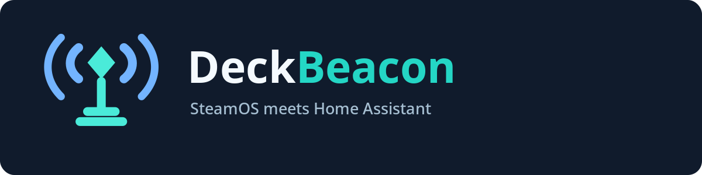
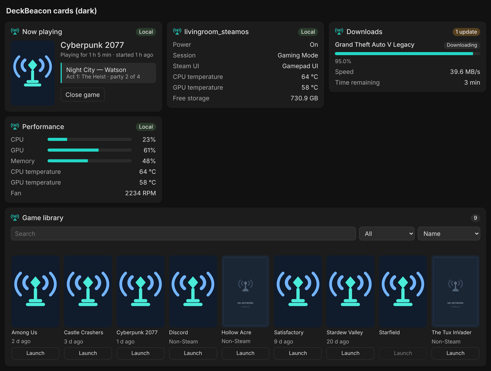

<p align="center"></p>

# DeckBeacon cards

Optional Lovelace cards for the [DeckBeacon integration](https://github.com/Jafesu/deckbeacon-homeassistant). The integration works fully without them.



| Card | Shows |
|---|---|
| `custom:deckbeacon-now-playing-card` | Current game with Steam artwork, session time, Rich Presence activity |
| `custom:deckbeacon-device-card` | Connection, power, Gaming/Desktop session, temperatures, storage |
| `custom:deckbeacon-downloads-card` | Download progress, speed, time remaining |
| `custom:deckbeacon-library-card` | Game library with artwork, search, filters, launch with confirmation |
| `custom:deckbeacon-performance-card` | CPU/GPU/memory with live trends, temperatures, fan |

Every card has a visual editor; `device_id` is optional (defaults to the first DeckBeacon device).

```yaml
type: custom:deckbeacon-library-card
device_id: <your device>   # optional
sort: recent               # optional: name | recent
```

A ready-made dashboard with one view per device:

```yaml
strategy:
  type: custom:deckbeacon
```

## Install
Marketplace → **Add from link** → `https://github.com/Jafesu/deckbeacon-card` (type: Dashboard). The resource is registered automatically.

> **Pre-release.** Generated from the [DeckBeacon monorepo](https://github.com/Jafesu/DeckBeacon); issues and docs live there. Version 0.2.0, monorepo commit `2fdbb4d`.
